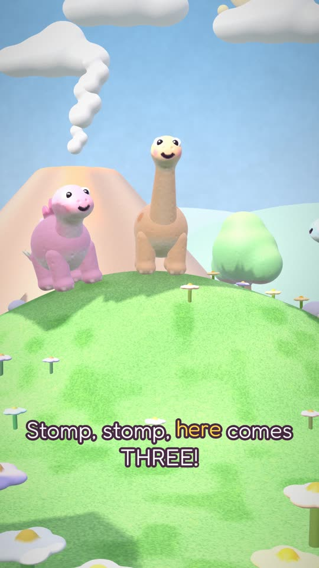
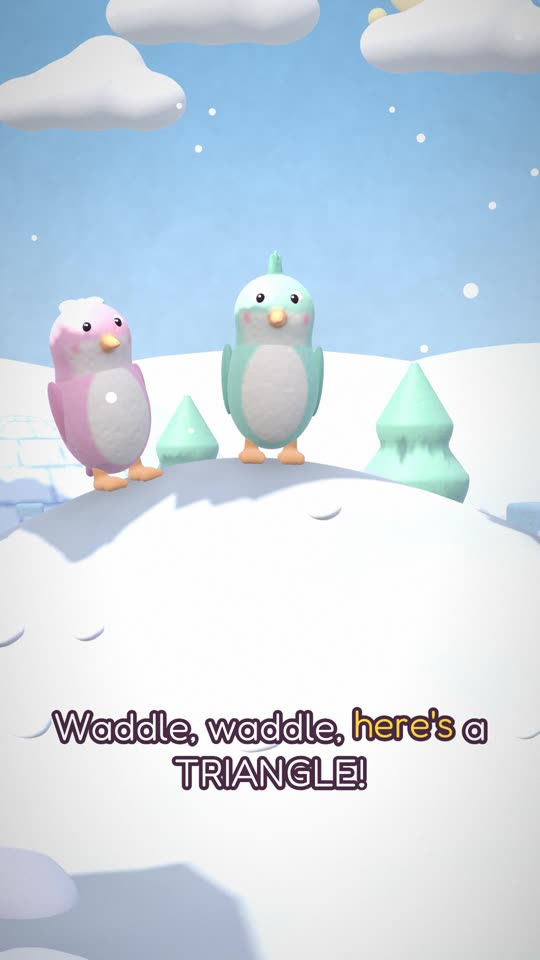
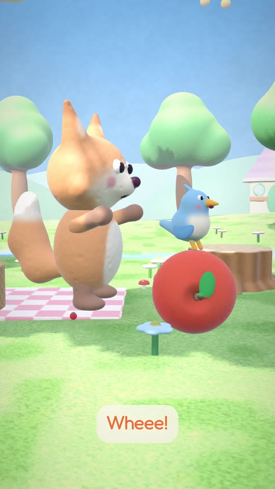
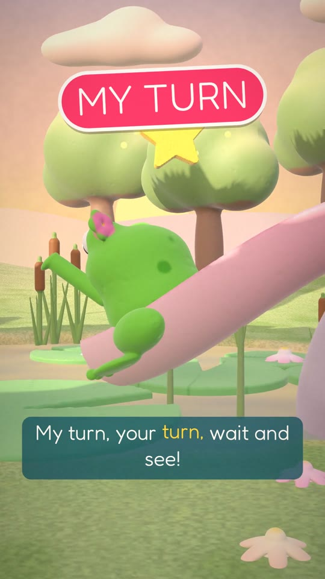

# Kids Shorts archive

A record of every 45-second children's Short made by the Kids Shorts pipeline: 3D claymation built in code
(signed-distance-field clay models, a GPU renderer, sung text-to-speech tuned to an original melody).
Each episode folder holds the plan (prompt, shot list, lyrics), the music fingerprint, the reviewer report,
8 stills and the code that rendered it. Audio and video files stay out of the repo.

Every new run reads this archive first and must differ from it: new format, world, shots and song
(see [ENGINE.md](ENGINE.md)).

## Episodes

| Still | Title | Format | Lesson | Voice | Status |
|---|---|---|---|---|---|
|  | [Dino Count!](episodes/2026-10-09-pm-dino-count/plan.md) | song-and-reveal (v1 template) | counting 1 to 5 and back down | am_eric | reference template |
|  | [Penguin Shapes!](episodes/2026-10-10-pm-penguin-shapes/plan.md) | song-and-reveal (v1 template, owner rejected) | shapes: circle, square, triangle, star, heart | af_heart | rejected (template reskin) |
|  | [Tumble & Pip, Episode 1: What's the Weather?](episodes/2026-10-10-pm-tumble-pip-weather/plan.md) | series episode 1 (series: Tumble & Pip) | weather: sunny, cloudy, windy, rainy, rainbow | am_eric | r2, reviewer PASS |
|  | [Tumble & Pip, Episode 2: Big and Small!](episodes/2026-10-10-pm-tumble-pip-big-small/plan.md) | series episode 2 (series: Tumble & Pip) | big and small | ElevenLabs Music duet + TTS | reviewer PASS (round 3), QA 0 |
|  | [My Turn, Your Turn! (Lulu & Bo at the Pond)](episodes/2026-10-10-pm-lulu-bo-turns/plan.md) | story (one-off) | taking turns | af_heart (Bo spoken: am_eric) | done |

## Batches

Themed sets of Shorts that also join into one long-form episode.

| Batch | Series | Shorts | Episode | Status |
|---|---|---|---|---|
| [01: Fables About Friendship](batches/01-fables-friendship/plan.md) | Tumble & Pip | 10 Aesop retellings | Story Stump episode, about 9 min, 16:9 | approved, Fable 1 next |

## Layout

- `ENGINE.md`: the playbook each scheduled run follows.
- `history.json`: one line per finished video.
- `batches/<nn-slug>/plan.md`: batch plan (fables, song plan, episode running order, schedule).
- `episodes/<job_id>/`: `plan.md`, `music.json`, `review.md` (when reviewed), `stills*/`, `code/`.
- `tools/qa_geom.py`: geometry QA (objects passing through each other, floating perches, below-ground, pop check).
- `tools/REVIEWER.md`: brief for the independent reviewer agent.
- `engine/`: the original "Dino Count" toolkit (sing.py phrase autotune, audio mix chain, SDF mesher, renderer).

## Quality gates

1. Audio: tuning median under 5 cents, HNR at or above raw TTS, -14 LUFS, no sung line trimmed by more than 0.03 s.
2. Variety: music fingerprint differs from each of the last 10 on 4+ attributes; new format, world and shot list.
3. Geometry QA: 0 issues at 15 fps.
4. Reviewer agent: PASS on a frame-every-0.5 s review.
